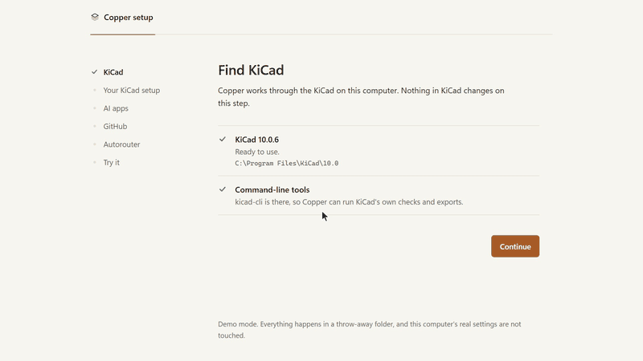
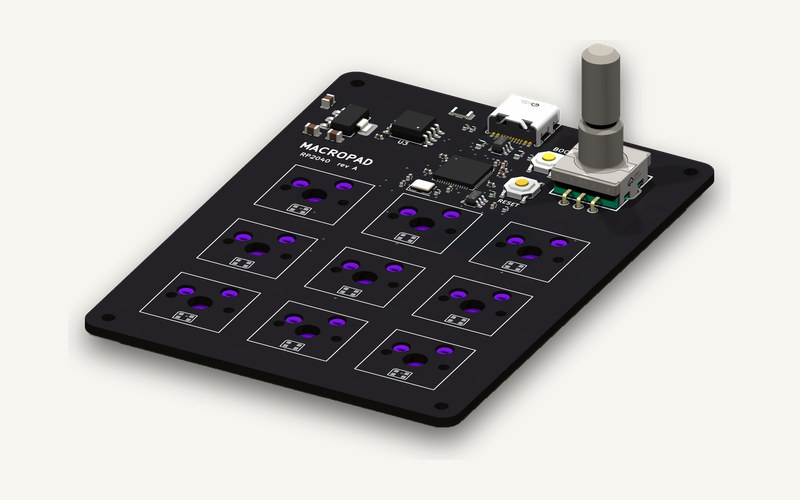
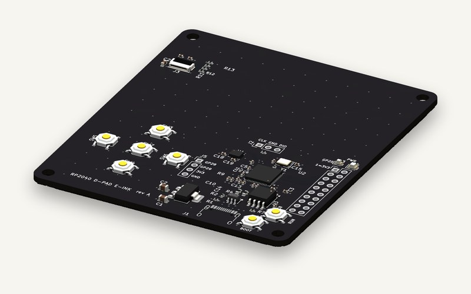
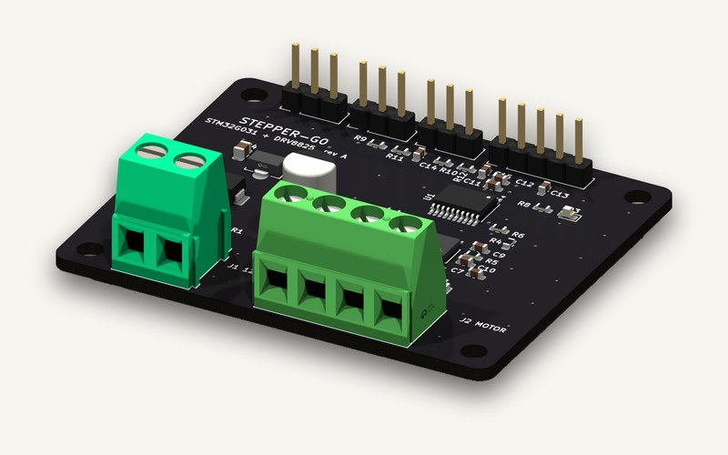
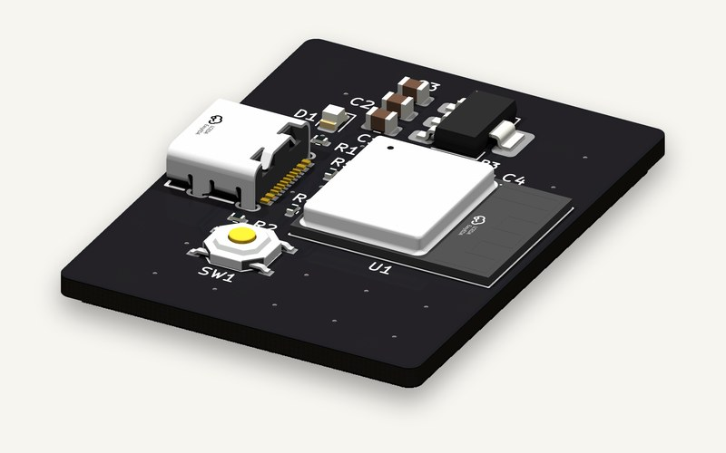
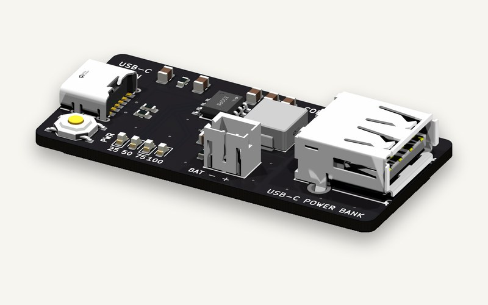
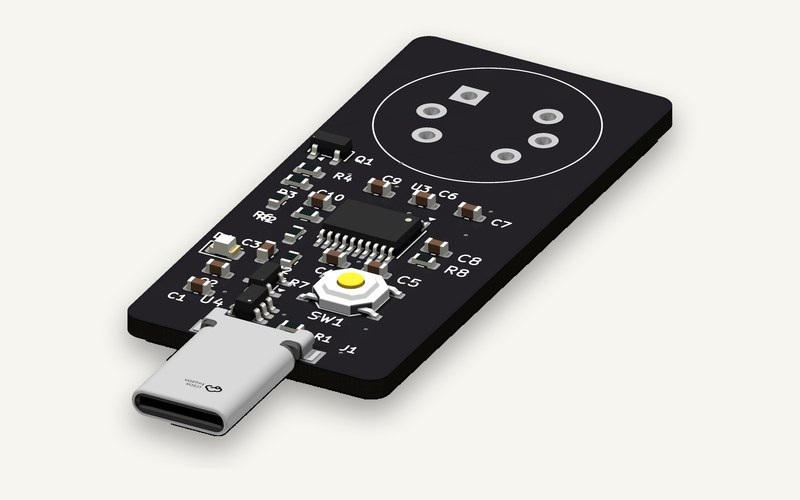

<!-- mcp-name: io.github.claynicholson/copper -->
# copper-kicad-mcp

Copper connects your AI app to KiCad, so it can design real boards you can order: schematic, LCSC parts, PCB
layout and routing, KiCad's own ERC and DRC, renders and JLCPCB fab files.

[](https://www.npmjs.com/package/copper-kicad)
[](LICENSE)

## Install

You need [KiCad 10](https://www.kicad.org/download/). Then pick one:

| You use | Do this |
|---|---|
| Windows, any AI app | Run `Copper-for-KiCad-1.1.0-Setup.exe` from the [latest release](https://github.com/claynicholson/copper-kicad-mcp/releases/latest) and tick your AI apps |
| Claude Desktop | Double-click `copper-1.1.0.mcpb` from the [latest release](https://github.com/claynicholson/copper-kicad-mcp/releases/latest) |
| Claude Code | The two plugin commands below |
| Cursor, VS Code, Windsurf, Codex, Zed and others | `npx -y copper-kicad setup` (Node.js 18+), or [add to Cursor](https://cursor.com/install-mcp?name=copper&config=eyJjb21tYW5kIjoibnB4IiwiYXJncyI6WyIteSIsImNvcHBlci1raWNhZCJdfQ%3D%3D) / [install in VS Code](https://vscode.dev/redirect/mcp/install?name=copper&config=%7B%22command%22%3A%22npx%22%2C%22args%22%3A%5B%22-y%22%2C%22copper-kicad%22%5D%7D) |
| A terminal | The one-line installer below |

```sh
# Claude Code
claude plugin marketplace add claynicholson/copper-kicad-mcp
claude plugin install copper@copper
```

```powershell
# Windows (PowerShell)
powershell -ExecutionPolicy Bypass -c "irm https://raw.githubusercontent.com/claynicholson/copper-kicad-mcp/main/installer/install.ps1 | iex"
```

```sh
# macOS / Linux
curl -LsSf https://raw.githubusercontent.com/claynicholson/copper-kicad-mcp/main/installer/install.sh | sh
```

Windows is tested end to end. The macOS and Linux routes are new: if one fails, please
[open an issue](https://github.com/claynicholson/copper-kicad-mcp/issues).

Setup finds KiCad, brings your libraries and settings along, connects your AI apps and makes a test call. It asks
before each step and backs up everything it changes. To paste a config instead, Cursor, Claude Desktop and Windsurf
take this entry ([docs/INSTALL.md](docs/INSTALL.md) has the others):

```json
{ "mcpServers": { "copper": { "command": "npx", "args": ["-y", "copper-kicad"] } } }
```



`npx -y copper-kicad setup --demo` runs the setup page on a throw-away folder, so you can look first. If something
does not work, `npx -y copper-kicad doctor` (or `copper doctor` after the Windows or one-line install) names the
fix. More in [docs/INSTALL.md](docs/INSTALL.md).

## What it does

Ask for something like "Design a USB-C powered ESP32-C3 board with a status LED, 30 x 40 mm". Your AI then works
through it the way an engineer would:

- It connects pins to nets by name (`U1.PA9 → USB_DP`), never by coordinates.
- It searches LCSC/JLCPCB for real parts (Basic parts first, live stock) and imports each part's symbol and
  footprint, plus its 3D model when EasyEDA has one.
- KiCad's ERC and DRC re-run after every change, and each finding comes with a ready fix.
- It places parts and routes the board: a staged router with length matching, differential pairs and width
  classes, copper pours, and Freerouting.
- It looks at its work: schematic, layer and ray-traced 3D renders go back to the model.
- It writes Gerbers, drill, BOM and placement files for JLCPCB (or PCBWay, OSH Park, generic), zipped.

Copper has 31 tools and works with any MCP app and any model. The model is your AI app's: the Copper server never
calls one.

## Boards made with Copper

<table>
<tr>
<td width="33%"><br>RP2040 Macropad: nine hot-swap keys and a knob. 66 x 90 mm, 2 layers, 65 parts.</td>
<td width="33%"><br>RP2040 D-pad E-ink: D-pad, e-ink FPC and IMU. 72 x 84 mm, 4 layers, 55 parts.</td>
<td width="33%"><br>Stepper G0: a 12 V stepper controller on one board. 58 x 48 mm, 2 layers, 40 parts.</td>
</tr>
<tr>
<td width="33%"><br>ESP32-C3 USB-C: Wi-Fi and BLE on USB-C. 30 x 40 mm, 2 layers, 15 parts.</td>
<td width="33%"><br>USB-C Power Bank: an IP5306 power bank with USB-C in. 50 x 24 mm, 2 layers, 22 parts.</td>
<td width="33%"><br>Phone Breathalyzer: an alcohol sensor that plugs into a phone. 22 x 48 mm, 2 layers, 30 parts.</td>
</tr>
</table>

All six pass KiCad 10's ERC and DRC with 0 errors and 0 unconnected items. Layer art and fab files (Gerbers,
drill, BOM, placement) are on [coppereda.com](https://coppereda.com).

## Docs

[Install](docs/INSTALL.md) · [Configuration](docs/CONFIG.md) · [Parts providers](docs/PROVIDERS.md) ·
[Fab profiles](docs/FAB_PROFILES.md) · [KiCad compatibility](docs/COMPATIBILITY.md) ·
[Architecture](docs/ARCHITECTURE.md) · [Changelog](CHANGELOG.md) · [Contributing](CONTRIBUTING.md) · [Security](SECURITY.md)

## Privacy

Copper runs on your machine. Your designs stay there, and there is no telemetry. It goes online only to:

- search and download parts: LCSC, JLCPCB and EasyEDA, with the jlcsearch.tscircuit.com mirror as a fallback
- check for a newer KiCad (gitlab.com) during `setup` and `doctor`; `COPPER_NO_UPDATE_CHECK=1` turns that off
- download Freerouting (GitHub) and a Java runtime (Adoptium), about 120 MB once, when you ask for autorouting
- sign in to GitHub, if you link it without the GitHub CLI

Installing fetches a little more: the `npx` launcher installs Pillow from PyPI if KiCad's Python lacks it, and the
one-line installers fetch [uv](https://docs.astral.sh/uv/), a Python 3.12 build and Pillow.

The MCP server and CLI never call a language model. The package also holds `copper_kicad.agent`, a chat sidecar for
a separate desktop app; nothing in the server or CLI starts it.

## License

[MIT](LICENSE). Copper is an independent project, not affiliated with KiCad, LCSC, JLCPCB or any other vendor named here.
